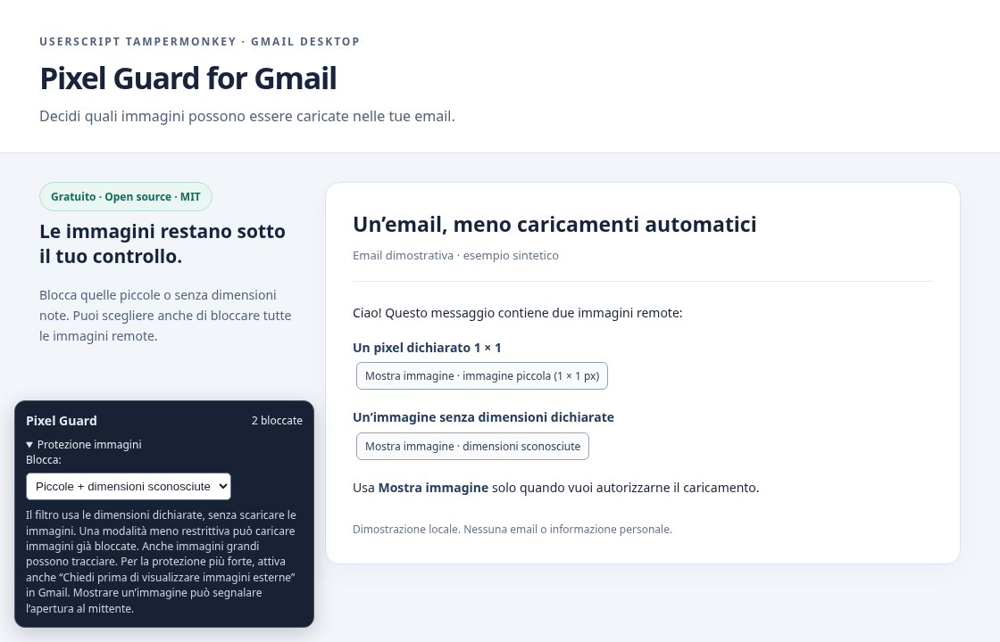

# Pixel Guard for Gmail

**Take control of remote images in your inbox.**

A free, open-source **Tampermonkey userscript** for desktop Gmail. Filter tiny images and images with unknown dimensions, or block all recognized remote message images. Reveal individual images when you choose.

[**Install Pixel Guard**](https://raw.githubusercontent.com/Lorenzo-D-B/Pixel/main/pixel-guard.user.js) · [Italiano](README.md) · [Releases](https://github.com/Lorenzo-D-B/Pixel/releases)



_The screenshot shows a local demonstration, without personal email or account data. The userscript's interface is currently in Italian._

## Install

1. Install and enable [Tampermonkey](https://www.tampermonkey.net/) in your browser.
2. Open the **[installation link](https://raw.githubusercontent.com/Lorenzo-D-B/Pixel/main/pixel-guard.user.js)** and confirm the installation in Tampermonkey.
3. Fully reload Gmail. The **Pixel Guard** panel appears in the bottom-left corner.

If the link displays code instead of an installation prompt, copy the whole file into **Tampermonkey → Create a new script**, replacing the editor contents, then save. If your browser or Tampermonkey reports that userscript execution is disabled, follow the extension's instructions to enable it. Node.js is only needed for development.

**Recommended Gmail setting:** Settings → See all settings → General → Images → **Ask before displaying external images**, then save your changes.

## Modes

| UI option                                      | What it does                                                                                                                    |
| ---------------------------------------------- | ------------------------------------------------------------------------------------------------------------------------------- |
| **Piccole + dimensioni sconosciute** — default | Blocks images with both declared dimensions ≤ **10 px**, hidden images and images without both dimensions known before loading. |
| **Solo piccole**                               | Blocks images with both dimensions ≤ **10 px** and hidden images. Unknown dimensions are allowed.                               |
| **Tutte le immagini remote**                   | Blocks all recognized HTTP(S) message images, regardless of declared size.                                                      |

Open **Protezione immagini** to change modes. The mode is saved in Gmail's local storage for your browser profile, shared across Gmail accounts in that profile. It stays tab-local if storage is unavailable.

Click **Mostra immagine** to reveal one image. This can notify its sender that the message was opened. Manual approvals last until a reload and are revoked if the image element receives a new URL. Choosing a less restrictive mode may immediately load previously blocked images. Choosing a stricter mode cannot undo earlier requests or manual approvals.

## What protection means

- The script uses declared HTML dimensions and inline pixel styles. It does **not** download or probe images to discover their natural size. Percentages are treated as unknown; an explicit zero or inline hiding is treated as hidden.
- It targets Gmail message containers and Gmail's `ci*.googleusercontent.com` image proxy, including common `src`, `srcset`, `picture`, HTML insertion and DOM construction paths. Gmail interface images and avatars are not intended targets.
- There is no analytics, telemetry or external backend operated by the script. Only the mode preference is persisted. Original image URLs stay in page memory to support manual reveal. Tampermonkey can check GitHub for script updates through its declared update URLs.
- **This is not a guarantee against all tracking.** A large image can track too. Parser/preload requests, late extension injection, TrustedHTML writes or unhooked APIs may start loads before the script can act. A blocked-image count does not prove that no request was made. Gmail's native image setting remains important.
- CSS background images, SVG, tracking links and other non-covered techniques are outside the script's scope. Gmail changes may require updates to selectors or hooks.

To uninstall, disable or delete **Pixel Guard — Gmail** in Tampermonkey and reload Gmail. To remove its saved preference, run `localStorage.removeItem("pixel-guard:mode:v1")` in the Gmail page console.

## Testing and development

The automated suite runs **16 tests in Chromium against a simulated Gmail page**, including network assertions and a test demonstrating the initial-parser limitation. The first version was also tried by its author in their own browser. Compatibility with every browser, account or Gmail update is not claimed; Firefox has not been validated by this suite.

Recommended: **Node.js 24 LTS**.

```bash
git clone https://github.com/Lorenzo-D-B/Pixel.git
cd Pixel
npm ci
npm run check
npx playwright install --with-deps chromium
npm test
```

Alternatively, use an existing Chromium with `CHROMIUM_PATH=/usr/bin/chromium npm test`. No Gmail account or credentials are needed. The `.user.js` file is the distributable; there is no build step.

## Support and contributions

See [CONTRIBUTING.md](CONTRIBUTING.md), open an [issue](https://github.com/Lorenzo-D-B/Pixel/issues), or read the [detailed Italian guide](docs/GUIDA.md). Do not post private messages, cookies, personal tracking URLs or credentials.

Released under the [MIT license](LICENSE). See [CHANGELOG.md](CHANGELOG.md) for release notes.
