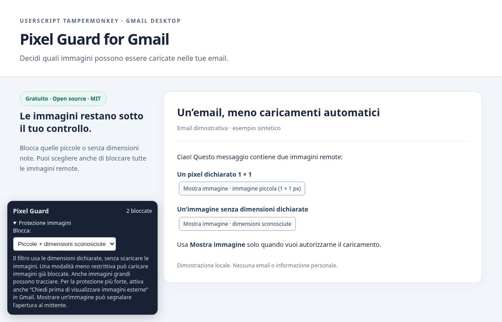

# Pixel Guard for Gmail

**Più controllo sulle immagini remote nelle tue email.**

Uno userscript gratuito e open source per **Tampermonkey** che filtra le immagini nelle email di Gmail desktop. Blocca le immagini piccole, gestisce quelle di dimensioni sconosciute e permette di scegliere quali mostrare.

[**Installa Pixel Guard**](https://raw.githubusercontent.com/Lorenzo-D-B/Pixel/main/pixel-guard.user.js) · [Guida completa](docs/GUIDA.md) · [English](README.en.md) · [Release](https://github.com/Lorenzo-D-B/Pixel/releases)

[](https://github.com/Lorenzo-D-B/Pixel/actions/workflows/tests.yml)
[](LICENSE)



_L'immagine mostra una dimostrazione locale, senza email o dati personali._

## Inizia in un minuto

1. Installa e abilita [Tampermonkey](https://www.tampermonkey.net/) nel browser.
2. Apri **[Installa Pixel Guard](https://raw.githubusercontent.com/Lorenzo-D-B/Pixel/main/pixel-guard.user.js)** e conferma l'installazione in Tampermonkey.
3. Ricarica Gmail: il pannello **Pixel Guard** compare in basso a sinistra.

Se il link mostra soltanto il codice, copialo in **Tampermonkey → Crea un nuovo script**, sostituendo tutto il contenuto dell'editor, e salva. Per usare lo script basta Tampermonkey; Node.js serve soltanto agli sviluppatori.

**Consigliato:** in Gmail, apri **Impostazioni → Visualizza tutte le impostazioni → Generali → Immagini** e attiva **Chiedi prima di visualizzare immagini esterne**. Salva le impostazioni.

## Scegli cosa bloccare

| Modalità                                           | Comportamento                                                                                                                      |
| -------------------------------------------------- | ---------------------------------------------------------------------------------------------------------------------------------- |
| **Piccole + dimensioni sconosciute** — predefinita | Blocca immagini dichiarate fino a **10×10 px**, immagini nascoste e immagini senza entrambe le dimensioni note prima del download. |
| **Solo piccole**                                   | Blocca immagini fino a **10×10 px** e immagini nascoste; lascia caricare quelle di dimensioni sconosciute.                         |
| **Tutte le immagini remote**                       | Blocca tutte le immagini HTTP(S) riconosciute come parte del messaggio.                                                            |

Il pulsante **Mostra immagine** autorizza una singola immagine. La modalità viene ricordata nel browser; gli sblocchi manuali valgono fino alla ricarica. Passare a una modalità meno restrittiva può avviare nuovi download.

## Privacy e limiti

- **Nessuna telemetria o servizio esterno dello script.** Non vengono effettuate richieste di prova per scoprire le dimensioni. La preferenza della modalità resta nel `localStorage` di Gmail.
- **Filtro per immagini, non garanzia contro ogni tracciamento.** Anche un'immagine grande può tracciare; le dimensioni usate sono quelle dichiarate nel markup, non le dimensioni naturali scaricate.
- **Una richiesta già partita non si può annullare.** Lo script intercetta diversi percorsi di creazione delle immagini, ma il caricamento iniziale, Trusted Types e API non intercettate possono precederlo. Il contatore non certifica che nessuna richiesta sia partita: abbinalo all'impostazione nativa Gmail.
- CSS, SVG, link tracciati e altre tecniche non coperte restano fuori dall'ambito dello script.

Consulta la [guida completa](docs/GUIDA.md) per dettagli, aggiornamenti, disinstallazione e risoluzione dei problemi.

## Compatibilità e verifica

Pensato per **Gmail desktop su `mail.google.com` con Tampermonkey**. L'interfaccia è in italiano. La suite automatica contiene **16 test in Chromium su Gmail simulato**, con verifiche sulle richieste di rete e un test che dimostra il limite dei caricamenti avviati dal parser. La prima versione è stata provata anche dall'autore nel proprio browser; non è dichiarata compatibilità verificata con ogni browser, account o aggiornamento di Gmail.

## Sviluppo

Consigliato **Node.js 24 LTS**. Il file `.user.js` è pronto all'uso e non richiede build.

```bash
git clone https://github.com/Lorenzo-D-B/Pixel.git
cd Pixel
npm ci
npm run check
npx playwright install --with-deps chromium
npm test
```

Se Chromium è già installato, puoi usare `CHROMIUM_PATH=/usr/bin/chromium npm test`. I test simulano le richieste e non richiedono una casella Gmail o credenziali.

## Contribuire

Hai trovato un problema o vuoi proporre un miglioramento? Apri una [issue](https://github.com/Lorenzo-D-B/Pixel/issues) e leggi [come contribuire](CONTRIBUTING.md). Non includere email private, cookie o URL di tracking personali nelle segnalazioni.

Distribuito con [licenza MIT](LICENSE). Le modifiche alle versioni sono nel [changelog](CHANGELOG.md).
